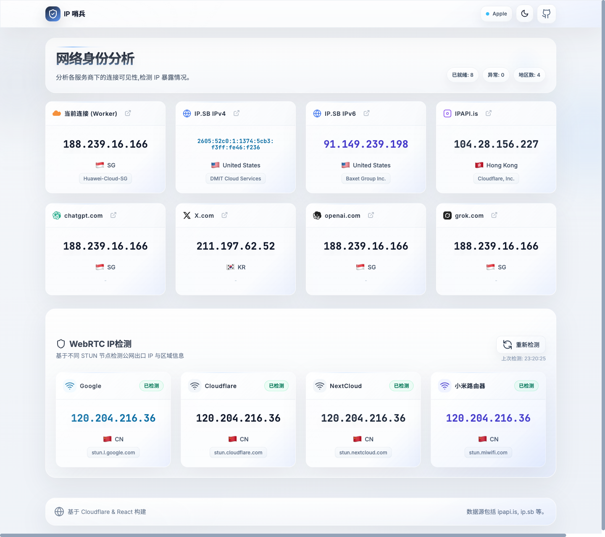
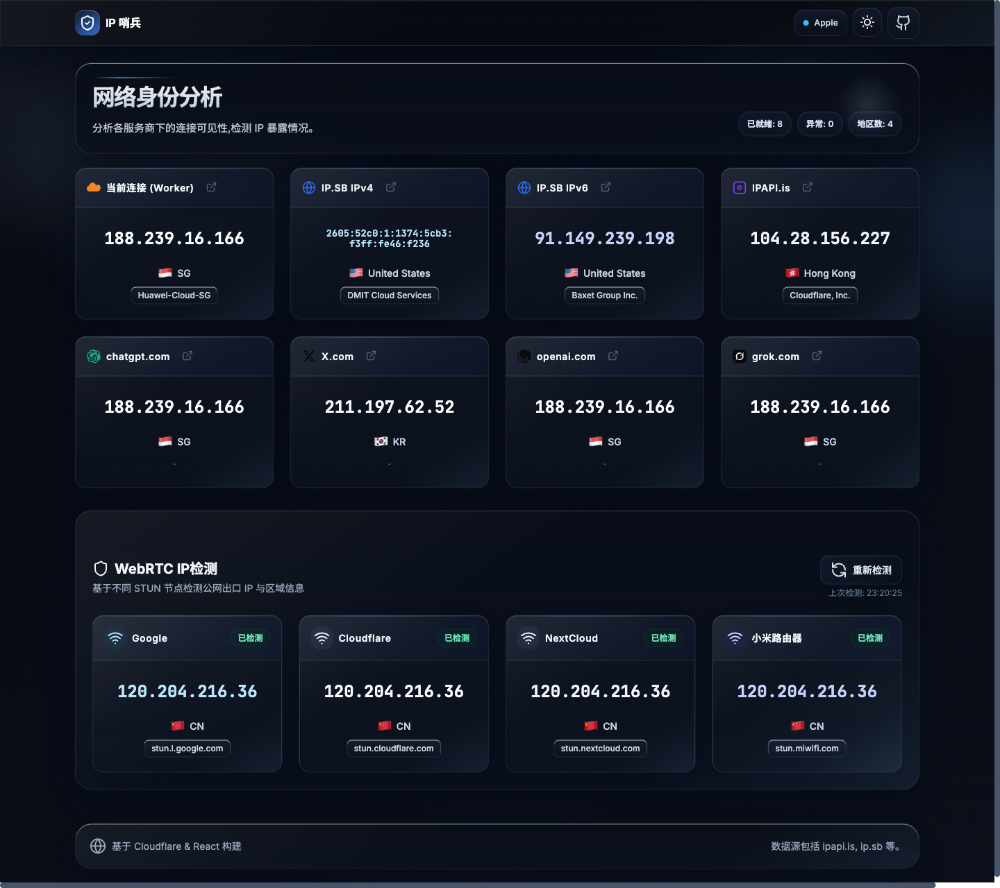

<div align="center">

#  IP 哨兵

**多源 IP 情报分析工具 · 网络身份可见性检测**

[](https://workers.cloudflare.com/)
[](https://react.dev/)
[](LICENSE)

分析各服务商下的连接可见性，检测 IP 暴露情况，通过实时风控评分检查代理/VPN 泄漏。

[**🚀 快速开始部署 →**](#-快速开始)

</div>

---

## 📸 界面预览

最新界面预览如下，包含更新后的 WebRTC 检测区域。

#### ☀️ 日间模式

<p align="center">
  
</p>

#### 🌙 夜间模式

<p align="center">
  
</p>

## ✨ 功能特性

### 🎨 风格与主题切换
界面右上角提供独立的 **风格切换按钮** 和 **明暗主题按钮**，可自由组合使用，便于在不同审美偏好下查看同一份网络诊断数据。

当前内置 3 套风格预设：

- **Linear** — 冷峻、克制、偏专业分析面板风格
- **Original** — 更明亮的蓝青色科技感风格
- **Apple** — 更柔和的玻璃质感与浅灰蓝层次风格

风格切换特性：
- 与浅色 / 深色主题 **相互独立**，可任意组合
- 当前选择会保存在浏览器 `localStorage` 中，刷新页面后仍会保留
- 上方 IP 状态卡片与下方 WebRTC 检测卡片会同步应用同一套视觉风格

### 🌐 多源 IP 检测
页面加载后会自动从 **8 个不同的数据源** 获取你的出口 IP；下方 **WebRTC 探测** 需手动点击开始检测，便于按需检查 IP 泄漏情况：

| 数据源 | 描述 |
|--------|------|
| **Cloudflare Worker** | 当前连接的 Inbound IP（服务端直出，最准确） |
| **IPv4 出口** | 纯 IPv4 地址，依次尝试 `ipv4.icanhazip.com`、`ipv4.myip.wtf`、`ipify` |
| **IPv6 出口** | 纯 IPv6 地址，依次尝试 `ipv6.myip.wtf`、`v6.ident.me`、`ipify`、`ipv6.icanhazip.com` |
| **ipwho.is** | 综合 IP 情报，失败时回退 `ipapi.is`、`ipinfo.io` |
| **ChatGPT** | 通过 `chatgpt.com` 的 CDN Trace 检测 |
| **X.com** | 通过 `help.x.com` 的 CDN Trace 检测 |
| **OpenAI** | 通过 `openai.com` 的 CDN Trace 检测 |
| **Grok** | 通过 `grok.com` 的 CDN Trace 检测 |
| **WebRTC 探测** | 通过 RTCPeerConnection ICE candidates 检测 IP 泄漏 |

### 🔍 IP 深度分析
点击任意 IP 地址，查看来自 `Net.Coffee`、`ipwho.is`、`ipapi.is`、`ip-api.com`、RDAP、StopForumSpam、Tor 出口列表与 Cloudflare / Google DoH PTR 的详细情报（Worker 端并行查询并自动合并）：

- **顶部摘要** — IP、国家 / 地区 / 城市 / ISP、IP 信誉分（直接使用 Net.Coffee 的 `trust_score`）
- **网络属性** — 注册国家、数据中心、移动网络、企业信息、机房名称
- **ASN / 运营商** — ASN、服务商、ASN 归属、ASN 组织、CIDR、ASN 自报类型、ASN IPv4 总量、ASN 注册日期
- **技术指标** — 地址类型、IP 范围、地址数量、预估带宽、Bogon、Reddit 限制、PTR、RPKI
- **风险深度检测** — VPN、代理、Tor、爬虫标记、滥用标记、滥用评分
- **地理位置** — 数据来源、国家 / 地区、地区、城市、纬度、经度

风险检测项固定展示：明确返回真 / 否时显示“已检测到 / 未检测到”，缺少结果时显示“暂无数据”；其他无数据的项不会渲染。信誉分与风险标记优先采用 Net.Coffee 返回值，其他源只补全缺失字段；如果 Worker 端请求 Net.Coffee 被限流，弹窗会从浏览器直连 Net.Coffee 补拿信誉分。

### 🎯 VPN / 代理泄漏检测
通过对比多个数据源返回的 IP 和地理位置，快速判断是否存在：
- 代理/VPN 泄漏（不同平台看到不同 IP）
- **WebRTC 泄漏** — 通过 RTCPeerConnection ICE candidates 检测本地/公网 IP 暴露

## 🛠️ 技术架构

```
┌──────────────────────────────────────────────┐
│              浏览器 (React 18)                │
│  ┌─────────┐ ┌──────────┐ ┌───────────────┐  │
│  │ 状态卡片 │ │ 详情弹窗 │ │ 信誉分 / 风险  │  │
│  └────┬────┘ └────┬─────┘ └───────────────┘  │
│       │           │                           │
│  直接请求外部 API    通过 Worker 中转           │
└───────┼───────────┼──────────────────────────┘
        │           │
        ▼           ▼
┌──────────────┐  ┌─────────────────────┐
│ 外部 IP / Trace│  │ Cloudflare Worker    │
│ ipwho.is 等   │  │ (API 中转 + SSR 注入) │
│              │  │ → ip.net.coffee      │
│              │  │ → ipapi.is / ipwho.is│
│              │  │ → ip-api.com         │
└──────────────┘  └─────────────────────┘
```

- **前端**：React 18 + Tailwind CSS（通过 CDN 引入，单文件 SPA）
- **后端**：Cloudflare Workers（零服务器，边缘计算）
- **API 中转**：Worker 代理 IP 详情请求；任一数据源失败时自动切换下一个，规避 CORS 与单点故障
- **SSR 注入**：服务端直接注入 Cloudflare 识别的访客 IP 和地理信息

## 🔒 安全特性

- **SSRF 防护** — 严格校验 IP/域名输入格式
- **XSS 防护** — JSON 数据安全转义后注入 HTML
- **安全响应头** — `X-Content-Type-Options`、`X-Frame-Options`、`Referrer-Policy`
- **CORS 控制** — 配置跨域资源共享策略

## 🚀 快速开始

### ⚡ 一键部署

点击下方按钮，即可自动跳转到 Cloudflare 部署页面，自动克隆仓库并完成部署：

[](https://deploy.workers.cloudflare.com/?url=https://github.com/jy02739244/ip-query-worker)

### 🔗 Fork 部署（推荐）

Fork 部署可以保持与上游仓库的关联，方便后续同步更新：

**第一步**：Fork 本仓库到你的 GitHub 账号

[](https://github.com/jy02739244/ip-query-worker/fork)

**第二步**：点击下方按钮，选择 **Continue with GitHub**，然后选择你 Fork 的仓库进行部署

[](https://dash.cloudflare.com/?to=/:account/workers-and-pages/create)

> [!TIP]
> 当上游仓库更新后，你可以在 GitHub 中点击 **Sync fork** 同步最新代码，Cloudflare 会自动重新构建部署。

### 手动部署（无需本地环境）

如果不想配置本地开发环境，可以直接通过 Cloudflare Dashboard 手动部署：

1. 登录 [Cloudflare Dashboard](https://dash.cloudflare.com/)
2. 进入 **Workers & Pages** → 点击 **创建** → 选择 **创建 Worker**
3. 为 Worker 命名并点击 **部署**（先部署默认的 Hello World 代码）
4. 部署成功后，点击 **编辑代码**
5. 将本项目 `src/_worker.js` 文件的 **全部内容** 复制并粘贴到编辑器中，替换原有代码
6. 点击右上角 **部署** 按钮保存并发布

> [!TIP]
> 后续更新时，只需重复步骤 4-6，将最新的 `src/_worker.js` 内容粘贴并重新部署即可。

### 前置条件

- [Node.js](https://nodejs.org/) >= 18
- [Wrangler CLI](https://developers.cloudflare.com/workers/wrangler/) (Cloudflare Workers CLI)

### 本地开发

```bash
# 克隆仓库
git clone https://github.com/jy02739244/ip-query-worker.git
cd ip-query-worker

# 安装依赖
npm install

# 启动本地开发服务器
npm run dev
```

访问 `http://localhost:8787` 即可预览。

### 界面操作说明

启动后可在页面右上角看到两个独立的界面控制按钮：

- **风格切换按钮**：位于夜间模式按钮左侧，点击后会在 `Linear`、`Original`、`Apple` 三种风格之间循环切换
- **主题切换按钮**：用于切换浅色 / 深色模式

说明：
- 风格切换不会影响检测逻辑、数据源或风险分析结果，仅调整界面视觉表现
- 所有风格都兼容浅色与深色模式
- 当前风格与主题偏好都会持久化保存，下次打开页面时自动恢复

### 部署到 Cloudflare

```bash
# 登录 Cloudflare
npx wrangler login

# 部署
npm run deploy
```


### 运行测试

```bash
npm test
```

## 📁 项目结构

```
ip-query-worker/
├── src/
│   └── _worker.js       # 核心代码（Worker + React SPA 单文件）
├── docs/
│   ├── screenshot.png    # 界面截图（日间模式）
│   └── screenshot-dark.png # 界面截图（夜间模式）
├── package.json          # 项目配置 & 依赖
├── wrangler.toml         # Cloudflare Workers 配置
├── vitest.config.js      # 测试配置
└── README.md             # 项目说明
```

## 📊 数据源说明

| 数据源 | 用途 | 请求方式 |
|--------|------|----------|
| `Cloudflare cf` 对象 | 当前连接 IP（服务端） | Worker SSR 注入 |
| `ipv4.icanhazip.com` / `ipv4.myip.wtf` / `ipify` | IPv4 出口地址 | 浏览器直连 |
| `ipv6.myip.wtf` / `v6.ident.me` / `ipify` | IPv6 出口地址 | 浏览器直连 |
| `ipwho.is` | 当前 IP + 地理信息（卡片 / 详情补全源） | 浏览器直连 + Worker 中转 |
| `ipapi.is` | 综合 IP 情报（卡片回退 / 详情数据源） | 浏览器直连 + Worker 中转 |
| `ip-api.com` | 网络类型标记（hosting / mobile / proxy） | Worker 中转 |
| `ip.net.coffee` | 参考项目同源：信誉分、风险标记、PTR、ASN 元数据 | Worker 中转 |
| `ipinfo.io` | 当前 IP 回退源 | 浏览器直连 |
| `rdap.arin.net` → 各 RIR RDAP | RIR、网络范围、路由、滥用联系方式 | Worker 中转 |
| `stopforumspam.com` | 垃圾信息举报次数、滥用标记 | Worker 中转 |
| `check.torproject.org` | Tor 出口节点判定 | Worker 中转（缓存 1 小时） |
| `cloudflare-dns.com/dns-query` / `dns.google/resolve` | PTR 反向解析 | Worker 中转 |
| `*/cdn-cgi/trace` | CDN 出口 IP | 浏览器直连 |
| `RTCPeerConnection` | WebRTC 泄漏检测（本地/公网 IP） | 浏览器 API |

> 旧的 `api-ipv4.ip.sb`、`api-ipv6.ip.sb` 与 `api.cmliussss.net` 已不可用，本项目已改为上述多源回退链；任一源失败会自动切换，不再依赖单一服务。
>
> 信誉分直接使用 Net.Coffee 返回的 `trust_score`，与参考项目 `one-ip` 保持一致，不再使用本地启发式公式。不同数据源返回的字段并不完全一致，详情弹窗只展示实际拿到的项目；IP 归属、ASN、网络范围、PTR、Tor/垃圾信息标记等会由其他源补全。

## 📝 许可证

本项目基于 [MIT](LICENSE) 许可证开源。

## 🙏 致谢

- [Cloudflare Workers](https://workers.cloudflare.com/) — 边缘计算平台
- [Net.Coffee](https://ip.net.coffee/) — 信誉分与 IP 情报数据源
- [ipapi.is](https://ipapi.is/) — IP 情报 API
- [ipwho.is](https://ipwho.is/) — IP 归属地与 ASN 数据
- [ip-api.com](https://ip-api.com/) — 网络类型标记
- [RDAP](https://rdap.org/) — RIR、网络范围与滥用联系方式
- [StopForumSpam](https://www.stopforumspam.com/) — 垃圾信息举报数据
- [Tor Project](https://www.torproject.org/) — Tor 出口节点列表
- [ipify](https://www.ipify.org/) / [icanhazip](https://icanhazip.com/) / [ident.me](https://ident.me/) — 出口 IP 探测
- [React](https://react.dev/) — 前端框架
- [Tailwind CSS](https://tailwindcss.com/) — CSS 框架
- [one-ip](https://github.com/zhihui-hu/one-ip) — 多源校验与回退思路参考
- [Cmliu Github](https://github.com/cmliu) — CM
